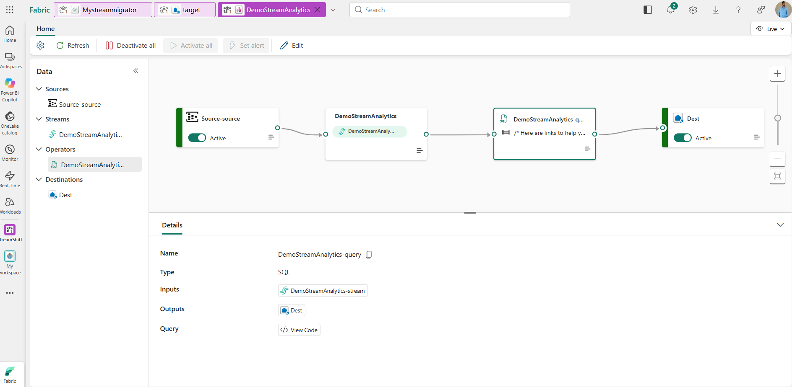
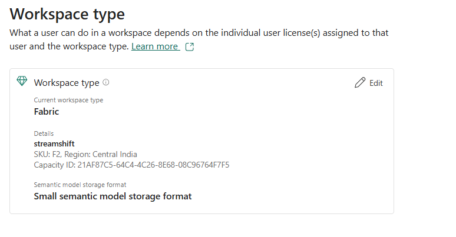
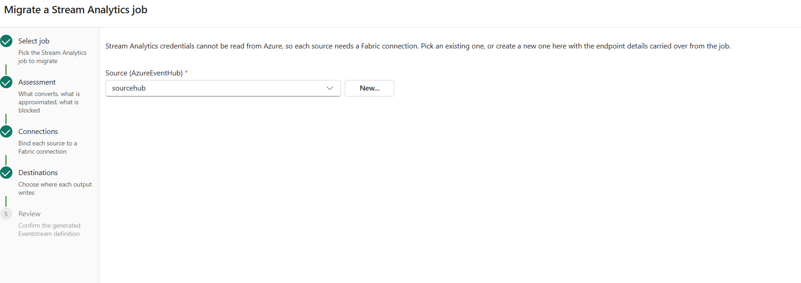
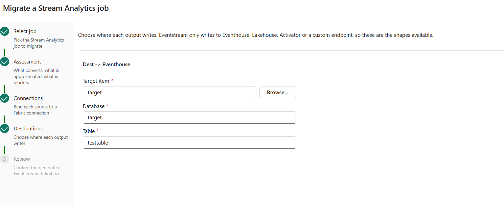
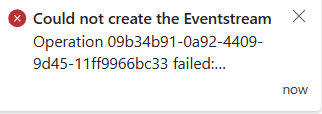

# StreamMigrator: run in dev mode and migrate a Stream Analytics job

This walkthrough shows how to run the StreamShift workload (`Org.StreamShift`) in **Fabric dev mode** and migrate an Azure Stream Analytics (ASA) job into a Fabric Eventstream with the **StreamMigrator** item.

In dev mode, Fabric loads the workload from your machine. The DevGateway registers the workload manifest against one workspace, and the editor UI is served from a local dev server. Only the signed-in developer sees the workload, and only while both processes are running.

End result: an Eventstream that reads the ASA job's Event Hub input, runs the ASA query in a SQL operator, and writes to an Eventhouse KQL database.



## Prerequisites

| Requirement | Notes |
|---|---|
| Fabric tenant | Sign in to the tenant the workspace lives in, both in the browser and in the Azure CLI. |
| Fabric workspace on a capacity | Fabric (F SKU) or trial capacity. Dev-mode registration fails on a workspace without one. |
| Entra app for the frontend | `FRONTEND_APPID` in `Workload/.env.dev`. Created by `scripts/Setup/CreateDevAADApp.ps1`. |
| Node.js, .NET, Azure CLI | Node for the dev server, .NET for the DevGateway, `az` to get a Fabric token. |
| PowerShell 7 (`pwsh`) | Recommended. The scripts use `$IsWindows`, which Windows PowerShell 5.1 doesn't define. See [Without PowerShell 7](#without-powershell-7). |
| Fabric Developer Mode | Fabric → ⚙️ Settings → **Developer settings** → **Fabric Developer Mode**: on. |
| Tenant setting | Admin portal → Tenant settings → **Workspace admins can develop partner workloads**: enabled for you. Needs a Fabric admin. |
| ASA job and Event Hub | The source job, plus a Fabric connection to its Event Hub (you can create one inside the wizard). |
| Eventhouse with a KQL database | The destination for the migrated output. |

## 1. Put the workspace on a capacity

Workspace settings → **Workspace type** → **Edit** → pick a Fabric or trial capacity.



Or assign it with the REST API:

```bash
curl -X POST \
  -H "Authorization: Bearer $(az account get-access-token --resource https://api.fabric.microsoft.com --query accessToken -o tsv)" \
  -H "Content-Type: application/json" \
  -d '{"capacityId":"<capacity-id>"}' \
  https://api.fabric.microsoft.com/v1/workspaces/<workspace-id>/assignToCapacity
```

`HTTP 202` means the assignment was accepted.

> If you move the workspace to a different capacity later, restart the DevGateway (step 4) so it registers again.

## 2. Point the dev configuration at the workspace

`build/DevGateway/workload-dev-mode.json`:

```json
{
  "WorkloadEndpointURL": "http://localhost:60006/",
  "WorkspaceGuid": "<workspace-id>",
  "ManifestPackageFilePath": "<repo>\\build\\Manifest\\Org.StreamShift.1.0.0.nupkg"
}
```

`Workload/.env.dev` sets the workload name (`Org.StreamShift`), the items (`HelloWorld,StreamMigrator`), `FRONTEND_APPID` and `FRONTEND_URL=http://localhost:60006/`.

## 3. Build the manifest package and start the dev server

```powershell
# Build and validate the manifest package (build/Manifest/Org.StreamShift.1.0.0.nupkg)
.\scripts\Build\BuildManifestPackage.ps1 -Environment dev -ValidateFiles $true

# Start the dev server on http://localhost:60006
.\scripts\Run\StartDevServer.ps1
```

Wait for `DevServer is listening on port 60006` and `webpack ... compiled successfully`.

## 4. Start the DevGateway

Sign the Azure CLI in to the workspace's tenant first:

```powershell
az login --tenant <tenant-id>
az account show   # check the tenant before going on
```

Then start the gateway with an az CLI token:

```powershell
.\scripts\Run\StartDevGateway.ps1 -InteractiveLogin $false
```

Leave the window open. Success looks like this:

```
info: Registering dev instance...
info: Dev instance registered successfully
info: DevGateway started
```

> The token from `az` is passed in at startup and expires after about an hour. Restart the gateway when it does.

### Without PowerShell 7

On Windows PowerShell 5.1, `$IsWindows` is undefined, so the scripts take the macOS/Linux branch and fail. Either install PowerShell 7, or set the variable before calling a script:

```powershell
$IsWindows = $true; .\scripts\Build\BuildManifestPackage.ps1 -Environment dev
```

You can also run the gateway executable directly, with the same arguments the script uses:

```bash
TOKEN=$(az account get-access-token --scope https://analysis.windows.net/powerbi/api/.default --query accessToken -o tsv)
./tools/DevGateway/Microsoft.Fabric.Workload.DevGateway.exe -LogLevel Information \
  -DevMode:UserAuthorizationToken "$TOKEN" \
  -DevMode:ManifestPackageFilePath "<repo>\\build\\Manifest\\Org.StreamShift.1.0.0.nupkg" \
  -DevMode:WorkspaceGuid <workspace-id>
```

## 5. Create a StreamMigrator item

1. In Fabric, hard refresh (Ctrl+F5) and check Developer Mode is still on.
2. Open the dev workspace → **+ New item** → search **StreamMigrator**. Dev items carry the `-dev` suffix from `ENVIRONMENT_DISPLAY_NAME_SUFFIX`.
3. Create the item. The editor loads from `localhost:60006`.

## 6. Run the migration wizard

### Select job

Pick the Azure subscription and the Stream Analytics job. The job's inputs, outputs and query are read through Azure Resource Manager.

### Assessment

The wizard shows what converts directly, what is approximated, and what is blocked. Migration stays disabled while anything is blocked. Common blockers are UDFs, geospatial or anomaly-detection functions, more than one stream input, and outputs with no Eventstream equivalent.

### Connections

ASA never returns credentials, so every source needs a Fabric connection. Pick an existing one, or click **New…** to create one with the Event Hub endpoint filled in from the job.



### Destinations

For each ASA output, choose where it writes.



For **Eventhouse** outputs, **Browse…** selects the **KQL database**, not the Eventhouse. Fabric resolves the cluster from the database item. The Database field fills in from your pick. Type the **Table** name exactly: KQL table names are case-sensitive.

### Review

1. Enter the **Eventstream name**. It can't contain `_` or `.`, because Fabric documents those as incompatible with the SQL operator.
2. Check the generated `eventstream.json`. It's exactly what will be sent.
3. Finish the wizard to create the Eventstream in the item's workspace.

A correct definition for a one-input, one-output job looks like this:

```json
{
  "sources": [
    { "name": "Source-source", "type": "AzureEventHub",
      "properties": { "dataConnectionId": "<connection-id>", "consumerGroupName": "<consumer-group>", "...": "..." } }
  ],
  "streams": [
    { "name": "DemoStreamAnalytics-stream", "type": "DefaultStream",
      "inputNodes": [ { "name": "Source-source" } ] }
  ],
  "operators": [
    { "name": "DemoStreamAnalytics-query", "type": "SQL",
      "inputNodes": [ { "name": "DemoStreamAnalytics-stream" } ],
      "properties": { "query": "SELECT * INTO Dest FROM [DemoStreamAnalytics-stream]", "...": "..." } }
  ],
  "destinations": [
    { "name": "Dest", "type": "Eventhouse",
      "properties": { "dataIngestionMode": "ProcessedIngestion", "workspaceId": "<workspace-id>",
                      "itemId": "<kql-database-id>", "databaseName": "target", "tableName": "TestTable" },
      "inputNodes": [ { "name": "DemoStreamAnalytics-query" } ] }
  ],
  "compatibilityLevel": "1.0"
}
```

## 7. Result

The Eventstream opens with `Source-source → <name>-stream → <name>-query (SQL) → Dest`. The SQL operator's input is the default stream and its output is the destination (see the screenshot at the top).

## How the migrator maps a job

| ASA | Eventstream | Naming |
|---|---|---|
| Stream input | Source → DefaultStream | Source `<input>-source`. Default stream `<eventstream name>-stream`, which is what Fabric names it. |
| Transformation query | SQL operator | `<job>-query`. `FROM <input>` is rewritten to `FROM [<eventstream name>-stream]`; comments are left alone. |
| Output | Destination fed directly by the SQL operator | Named after the output, using the query's `INTO` spelling. |
| Out-of-order / late-arrival policy | SQL operator `advancedSettings` | Carried over unchanged. |

## Troubleshooting

Create failures show as a toast with a truncated message:



Get the full error from the operation ID in the toast:

```bash
curl -s -H "Authorization: Bearer $(az account get-access-token --resource https://api.fabric.microsoft.com --query accessToken -o tsv)" \
  https://api.fabric.microsoft.com/v1/operations/<operation-id>
```

| Symptom / error | Cause | Fix |
|---|---|---|
| DevGateway: `Forbidden ... "errorCode":"FeatureNotAvailable"` | Developer Mode or the tenant setting is off, or the workspace has no capacity. | Turn on Fabric Developer Mode, have an admin enable **Workspace admins can develop partner workloads**, assign a capacity, and retry. The setting can take a few minutes to apply. |
| Items don't show under **+ New item**; the DevGateway log shows no requests | The browser isn't requesting dev workloads. | Turn Developer Mode on (it often resets), check the browser is signed in to the right tenant, hard refresh. |
| Items stopped showing after a capacity change | The dev registration still points at the old capacity. | Restart the DevGateway. |
| Assessment: `The query writes INTO 'x', but no destination was generated for it` | The `INTO` target has no output of that name, or the output type is unsupported. | Add or fix the ASA output. Names differing only in case are handled. |
| `There are duplicated node names in the topology` | Two nodes share a name. | Fixed in the migrator: sources are suffixed and no stream shares a destination's name. |
| `Destination 'x' cannot be in a path that contains SQL operator followed by a derived stream` | A derived stream sat between the SQL operator and the destination. | Fixed in the migrator: the SQL operator feeds destinations directly. |
| `Unable to extract cluster URL from the Eventhouse KQL database item ID` | `itemId` is the Eventhouse, not its KQL database. | Re-pick the target with **Browse…**, which now selects KQL databases. |
| Review JSON has empty `dataConnectionId` / `itemId` after reopening the item | The plan was built without the saved selections. | Fixed in the migrator: re-selecting the saved job keeps the selections. |
| `'pwsh' is not recognized` in the dev server log | The dev server tries to rebuild the manifest with PowerShell 7. | Harmless: the existing package is still served. Install PowerShell 7 to remove it. |
